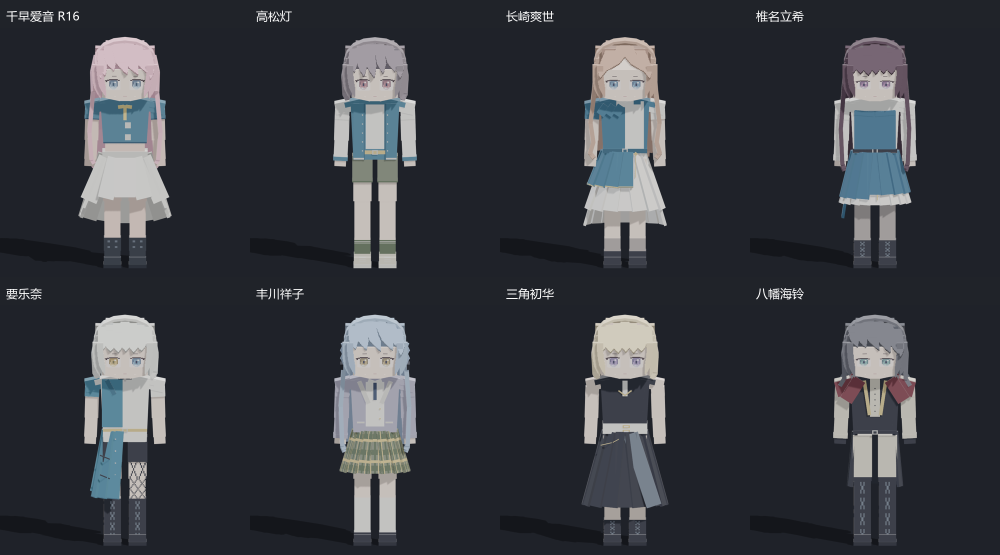
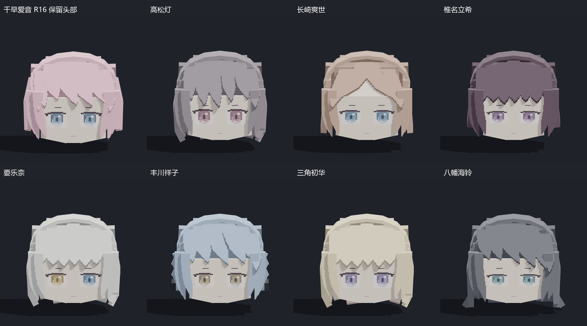
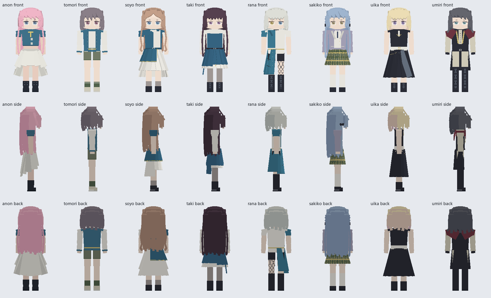

# Minecraft Character Modeling Workflow

[中文说明](README.md)

> **COMMERCIAL USE IS STRICTLY PROHIBITED. USE AT YOUR OWN RISK.** The current release is for personal learning, research and non-commercial creation. See [LICENSE](LICENSE) and [NOTICE.md](NOTICE.md), including the historical MIT licensing note.

**A Codex plugin based on Minecraft's block geometry and pixel-art visual language, designed for use with Blockbench.** It turns visual references into editable character models through deliberate face proportions, pixel-shaped facial features, layered rectangular hair, coherent body proportions and real multi-view review.

The plugin preserves already approved parts, records each iteration and checks actual model files. It is a Codex workflow plugin, not a JavaScript extension installed inside Blockbench. It does not promise a resemblance percentage or universal Minecraft import compatibility.

## Actual modeling examples

These are renders of actual editable models from the project, not concept art or Minecraft screenshots. Head close-ups use inspection copies; the complete projects retain their long hair. Results are examples, not guaranteed output for every prompt.







See [image provenance and rights](docs/images/README.md). The repository does not distribute the editable character projects, original references or third-party textures and animations.

## Included workflow

1. Inspect references and the real baseline model; identify the character's silhouette and facial relationships.
2. Freeze approved body/outfit groups and write a concrete iteration brief.
3. Refine the continuous face surface, shallow pixel features and organized rectangular hair strands.
4. Render front, both sides, back, three-quarter, face detail and normal viewing distance.
5. Inspect every view, record defects, revise, and distinguish structural checks from artistic acceptance.
6. Export for the actual Minecraft version, edition and loader. Generic Blockbench cuboids may require a dedicated entity renderer or format conversion.

The skill includes reference-analysis, geometry, tool/export and review guides, plus two original local helpers:

- `bbmodel_audit.py`: read-only structure/UV/texture checks and conservative group-freeze snapshots/comparisons; supports separate 5.x group definitions and inline groups.
- `contact_sheet.py`: arranges actual render files with source hashes. It does not render geometry or retouch character features.

## Install

With a Codex CLI supporting plugin marketplaces:

```sh
codex plugin marketplace add jiuxiansheng1111/blockbench-character-workflow
codex plugin add blockbench-character-modeling@jiuxiansheng-modeling
```

Alternatively, clone the repository, open it in a client supporting local marketplaces, and select its Minecraft character modeling plugin. Follow the client's refresh/restart instructions. The plugin package follows the [official packaging format](https://developers.openai.com/plugins/build/plugins).

## Use

Provide the actual project and references, then request:

> Use $blockbench-character-modeling. Keep the approved body and skirt. Refine the face, eyes and fringe using these references, preserve the long hair, and inspect matching front/side/back renders before delivering the Blockbench project.

The main skill and detailed guides are currently Chinese; this page provides an English introduction and usage instructions. Current user instructions and project rules remain authoritative.

## Local helper commands

Python 3.10+ is required. The audit tool uses only the standard library; contact sheets additionally require Pillow in your environment.

```sh
cd plugins/blockbench-character-modeling/skills/blockbench-character-modeling
python scripts/bbmodel_audit.py audit character.bbmodel --cuboids-only --output audit.json
python scripts/bbmodel_audit.py snapshot baseline.bbmodel --group body --group skirt --output locked.json
python scripts/bbmodel_audit.py compare candidate.bbmodel --baseline locked.json --output comparison.json
python scripts/contact_sheet.py --image front=front.png --image side=side.png --image back=back.png --output views.png
```

Use group UUIDs when names are ambiguous. Locked textures must be embedded. Shared-atlas changes are reported conservatively even when unrelated pixels changed. Existing output files are not overwritten. The audit does not evaluate intersections, world-space normals, resemblance or in-game behavior. See [validation details](VALIDATION.md).

## Optional MCP and boundaries

The independent [Blockbench MCP project](https://github.com/jasonjgardner/blockbench-mcp-plugin) can provide desktop HTTP or headless stdio modeling tools. This plugin does not bundle its code, install a server, change firewall settings or enable `risky_eval`. Verify create/read/render with a simple real asset before relying on a connection.

No game launch, model API request, upload or publication happens automatically through these helpers. Building, installing and in-game acceptance are distinct delivery stages. Minecraft and the depicted character designs remain the property of their respective rights holders; this is not an official product.
